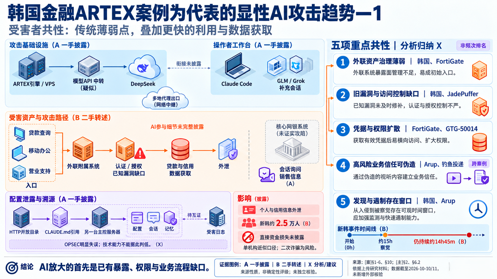
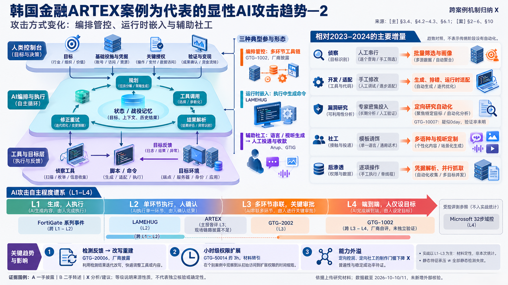
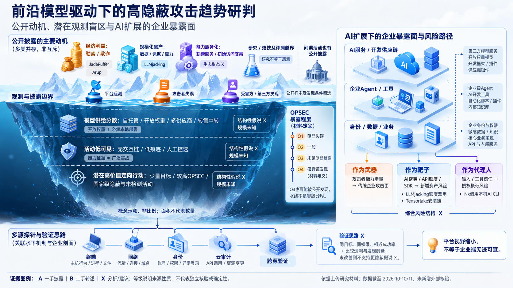
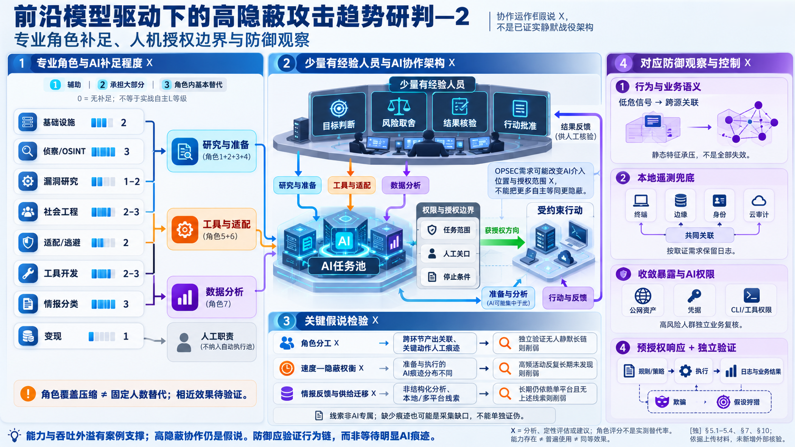
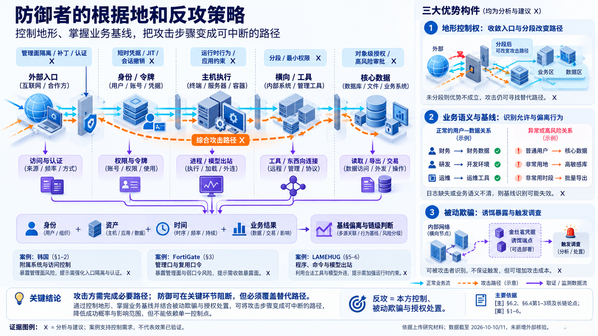

> 本文提供双语版本：**中文** · [English](/posts/ai-attacks-visible-trends-hidden-risks-en/)

最近整理 AI 驱动攻击案例时，我反复遇到一个问题：我们究竟是在讨论一种新的攻击能力，还是在给原有攻击链换一个更醒目的名字？

韩国金融业 ARTEX 事件给了一个很好的观察窗口。它有 AI Agent、多个模型、攻击基础设施和真实的数据外泄，也留下了会话、配置与记忆文件。但如果把“AI”两个字拿掉，入口仍然是暴露在外的附属系统、认证与授权缺口、未及时修补的漏洞；真正发生变化的，是攻击者组织这些能力的方式，以及覆盖目标的速度。

这也是我写这篇文章时刻意守住的边界：不把一次事件包装成“全自主攻击时代已经到来”，也不因为公开案例中的攻击者犯了不少低级错误，就低估 AI 对攻击生产方式的长期影响。

以下判断基于截至 2026 年 10 月 10—11 日整理的公开材料。关于已披露事件，我尽量回到一手报告；关于水面下的部分，只讨论可检验的假说，不把不可见当作存在的证据。

## 一、韩国金融 ARTEX 事件：AI 放大的首先是已有缺口

2026 年 10 月，CrowdStrike 披露了一起针对韩国金融机构的攻击活动。研究人员在攻击者控制的开放目录中发现了 Claude Code 会话、ARTEX 配置与记忆文件，并据此还原出两套环境：一台服务器承载 ARTEX 实例，另一台更像操作者的主控工作台。ARTEX 使用 DeepSeek 作为主要模型后端，其他会话还涉及 GLM 与 Grok。两套系统如何衔接，公开报告没有完整说明。[CrowdStrike 的原始披露](https://www.crowdstrike.com/en-us/blog/unknown-threat-actor-uses-artex-to-target-south-korean-finance/)也明确保留了受影响机构数量与个人线索的不确定性。

这起事件最容易被讲成“AI Agent 自主攻破多家银行”，但现有证据支撑不了这么完整的叙事。公开信息指向的是贷款查询、移动办公和营业支持等外联附属系统，并没有证据表明核心网银被攻陷；各家机构中 AI 具体执行了哪些步骤，也没有逐一披露。

能够较稳妥确认的，是几类并不新鲜的问题：外联资产治理不足，认证或对象级授权存在缺口，已知漏洞没有及时修补，攻击被发现和遏制之间仍有时间窗口。AI 没有改变这些问题的性质，却让侦察、尝试、结果解析和再次调整更容易连续运转。

这类变化在 Amazon 对另一场 FortiGate 攻击的调查中表现得更直接：攻击者没有依赖新的设备漏洞，而是利用公网管理面、弱口令和单因素认证，覆盖了 55 个以上国家的 600 多台设备；一旦遇到加固环境，攻击者往往转向更软的目标。Amazon 的判断很克制：AI 增强的是效率和规模，不是攻击者的技术深度。[这份调查](https://aws.amazon.com/blogs/security/ai-augmented-threat-actor-accesses-fortigate-devices-at-scale/)也提醒了我一个现实问题——AI 能力外溢最先改变的，可能不是顶尖攻防的上限，而是基础防护薄弱组织面对的攻击者下限。

ARTEX 事件还有另一层值得注意的地方。攻击者把配置、会话和长期记忆暴露在开放目录里，跨服务器引用又给调查人员留下了继续追踪的跳板。它说明 AI 工具在提高执行效率的同时，也会生成新的高密度取证对象。会话、项目指令、记忆、模型配置和工具调用记录一旦泄露，暴露的不只是一个文件，而是相当一部分操作上下文。

但这种溯源成功带有明显的幸存者偏差：我们之所以看得如此清楚，恰恰因为攻击者的 OPSEC 做得很差。它可以证明这种工作方式存在，不能证明更谨慎的使用者也会留下相同窗口。

## 二、攻击方式变化：从生成内容走向编排、执行与反馈

生成钓鱼邮件、改写脚本或解释漏洞，并不是最近才出现的能力。更值得关注的变化，是模型从一次性顾问进入了有状态的执行循环：规划任务，调用工具，读取结果，修正失败，再把过程写入战役记忆。

在这种结构里，人没有消失，而是向控制面上移：决定目标，准备基础设施与凭据，批准关键动作，判断结果是否可信，并处理外泄或变现。AI 更像执行面，承担原本需要多人反复切换工具和整理结果的中段工作。

公开案例中大致可以看到三种形态：

- 编排管控：模型把侦察、利用、凭据处理和数据分析串成多个连续阶段；
- 运行时嵌入：恶意程序在执行过程中调用模型生成或调整下一步内容；
- 辅助社工：模型生产多语种文本、语音或视频素材，但投递、施压和资金转移仍由人控制。

Anthropic 披露的 GTG-1002 是目前较强的编排型案例。厂商称攻击者用 Claude Code 覆盖了侦察、漏洞发现、横向移动、凭据收集和数据分析等环节，并保留人对目标选择和最终数据提取的控制。[Anthropic 的报告](https://www.anthropic.com/news/disrupting-AI-espionage)说明了长链执行已经具备现实性，但其中的自主比例、归因和“首次”判断仍来自平台方自身，应与独立验证区分开。

因此，与其争论某个案例到底是 L3 还是 L4，我更关心四个工程变化：

1. 单次问答变成了带状态的任务循环；
2. 工具输出可以直接成为下一步输入；
3. 失败反馈开始被用于改写脚本、调整路径和重新尝试；
4. 少量人员可以维持过去需要更多角色协作的吞吐量。

这些变化会压缩攻击周期，却不会自动消除幻觉、边界情况和环境差异。Amazon 观察到的攻击者能够批量生成工具，却无法稳定编译自定义利用或处理非标准环境。Agent 能把一条熟悉的路跑得更快，并不意味着它已经学会在陌生地形里持续攻坚。

## 三、水面下的风险：不是“更强模型必然更隐蔽”

公开案例天然经过一道筛选：平台看见了异常，攻击者自己暴露了基础设施，受害方发现了入侵，或者第三方恰好捕获了样本。换句话说，我们看到的并不是“AI 攻击总体”，而是能够进入公开视野的子集。

这个区别很重要。ARTEX 和 FortiGate 案例留下大量可读材料，不代表 AI 使用者普遍如此粗糙；模型平台披露的滥用活动很多，也不代表发生在自托管模型、开放权重模型或第三方中转之外的活动很少。公开分布反映发现能力，也反映真实活动，但两者很难直接拆开。

我倾向于把未来的风险拆成三个可以分别验证的命题。

第一，模型供给正在分散。自托管、开放权重、多供应商与 API 中转会削弱任何单一平台对滥用行为的观察。平台视野缩小，不等于企业侧无迹可查；它只是把发现责任更多地推回终端、网络、身份和云审计。

第二，AI 可能让少量高水平人员覆盖更多专业环节。这里有能力证据，却缺少普遍性证据。一次评测能证明某种能力已经出现，不能证明它已被大量攻击者稳定使用。

第三，高隐蔽性更可能来自“能力类别加人的纪律”，而不是 Agent 的默认行为。高并发、节奏规整和冗余遍历通常更吵；真正追求隐蔽的使用者，可能把 AI 更多放在攻击前的目标研究、工具准备和离线分析阶段，在执行阶段由人降低频率、控制授权并处理异常。

第三点目前仍是假说。它至少给出了可以观察的反证：如果未来反复出现高频、规律、长链的 Agent 活动却长期不被发现，那么“自动化天然更吵”这条判断就要被修正；如果高 OPSEC 案例仍然依赖人工控制关键节点，那么防御就不该只寻找明显的模型调用痕迹。

AI 同时还扩展了企业自身的暴露面。它既可以是武器，也可以是靶子和代理人：模型密钥、API 额度、开发框架与插件成为新资产；企业 Agent 则把不可信输入与内部工具权限连接起来。防御 AI 攻击不能只盯着攻击者用了什么模型，还要回答自己的 AI 服务拥有哪些身份、数据和执行能力。

## 四、专业角色补足：人机边界比“替代多少人”更重要

用“AI 相当于多少名安全专家”描述能力很诱人，也很容易失真。不同环节的可验证性差异很大：侦察、信息归类、脚本生成和结果整理高度模式化，模型可以承担大量重复工作；漏洞稳定化、强对抗环境中的适配、目标取舍和变现，则仍然依赖人的经验、风险判断和现实资源。

更准确的说法是，AI 正在压缩角色覆盖成本，而不是按固定比例替代团队。它可以让少量有经验的人覆盖研究准备、工具适配和数据分析，但有条件、有限度：

| 更容易补足的部分 | 仍然明显依赖人的部分 |
| --- | --- |
| 批量侦察、OSINT 整理、常规脚本与工具调用 | 目标价值判断与行动边界 |
| 结果解析、数据分类、报告与知识整理 | 未知环境中的深度攻坚 |
| 已知模式下的适配、重试和并行执行 | 利用稳定化、结果核验与风险取舍 |
| 多语种内容和初步社工素材 | 实时互动、信任经营与变现 |

这里真正值得防御方关注的，是授权边界发生了什么变化。过去人的注意力天然限制了操作频率；现在，同一个批准动作可能释放一批并行任务。过去工程师手工跨越的系统边界，现在可能被 Agent 通过工具权限连续跨越。权限仍然是原来的权限，爆炸半径却可能不同。

因此，检测对象不应只是“是否调用了 AI”，而应包括任务范围、工具调用、身份切换、停止条件和结果验证。对自有 Agent 也同样如此：模型的自我报告不能替代系统日志，高风险动作不能只靠提示词约束，不可逆操作需要独立审批，执行结果还要由业务事实或确定性验证器确认。

从攻击者视角看，我更愿意把“少量人员加 AI 任务池”当成一个待验证的组织假说。它预测跨环节产物会出现风格或上下文关联，也预测关键动作附近仍能找到人工介入的时间痕迹。若未来出现经独立验证、无需人工关口且长期保持低可见性的完整攻击链，这个假说就需要重写。

## 五、防御者的根据地：控制地形，检测路径，而不是猜模型

面对 AI 加速的攻击，防御方最容易走向两个极端：一种是继续等新的 IOC 和“AI 攻击指纹”；另一种是认为模型能力增长太快，现有防御已经失去意义。我认为两者都忽略了企业仍然掌握的东西——自己的地形、身份体系、业务语义和处置权限。

攻击者无论使用什么模型，仍然需要跨过一些必要路径：从外部入口获得立足点，取得身份或令牌，在主机上执行，访问内部工具，最终读取、导出或破坏数据。路径可以变化，但不能完全消失。防御要做的不是押注一个控制点，而是让替代路径同样付出成本，并让每一次跨界都留下可关联的事实。

我会把防御与检测响应拆成四层。

**第一层是收敛地形。** 管理面隔离，公网入口持续盘点，补丁与暴露程度联动排序，短时凭据、JIT 权限和会话撤销进入身份设计，核心数据保留对象级授权。韩国事件和 FortiGate 调查都说明，AI 最先吃掉的是长期无人负责的附属系统、复用凭据和缺少约束的管理面。

**第二层是建立跨源观测。** 终端记录进程、脚本和模型出站，网络记录连接与数据流，身份系统记录登录、令牌与权限变化，云审计记录 API 和资源变更。单个信号可能都很普通，组合起来才构成攻击路径。检测逻辑需要从“出现了某工具”转向“谁在什么资产上，以什么身份，在多长时间内，取得了什么业务结果”。

**第三层是把低危信号放回链里。** 异常 VPN 登录、凭据库读取、远程管理连接、模型 API 出站和批量数据访问，单独看未必足以告警；如果它们围绕同一身份、资产和时间窗口连续出现，风险意义就完全不同。AWS 对 FortiGate 事件的建议也是优先分析异常认证、DCSync、来自 VPN 地址池的横向连接以及备份凭据访问，而不是仅凭开源工具名称定性。

**第四层是预先设计响应。** 攻击提速之后，真正的瓶颈经常不是缺一个更聪明的模型，而是没有人被授权撤销会话、隔离设备或冻结高风险操作。可逆、边界明确的动作应由确定性策略执行；影响范围大或不可逆的动作进入人工审批；每次处置都要用日志和业务结果独立验证。响应自动化的价值，在于缩短已知动作的等待时间，而不是把最终判断交给另一个 Agent。

被动欺骗也值得放在这套地形里。金丝雀凭据和诱饵端点不能保证被触发，更不能代替分段和最小权限，但它们能让无差别遍历付出更高的暴露成本。这里的“反攻”只指本方范围内的暴露面收敛、欺骗、调查和授权处置，不包括侵入攻击者系统。

写到这里，我反而不太想用“AI 原生安全产品”作为结论。韩国 ARTEX 事件给我的启发更朴素：攻击生产正在变得连续、并行并带有记忆，而很多企业的防御仍是割裂的——资产表、身份日志、EDR、云审计和响应权限分散在不同团队里。

模型会继续变强，攻击者是否使用某个具体模型却未必可见。防御方真正可以积累的，是更清楚的资产边界、更短的身份链、更完整的本地遥测，以及一套知道何时该自动、何时必须停下来让人决定的响应机制。

这并不能保证每一步都拦住攻击。但它能让攻击者必须完成的路径变长、可替代路径变少，也让一次局部失守不再自然演变成整条链失守。对我来说，这比追逐一个想象中的“AI 攻击特征”更可靠。

---

主要参考资料：

- [CrowdStrike：Unknown Threat Actor Uses AI-Driven ARTEX to Target South Korean Finance](https://www.crowdstrike.com/en-us/blog/unknown-threat-actor-uses-artex-to-target-south-korean-finance/)
- [Amazon Threat Intelligence：AI-augmented threat actor accesses FortiGate devices at scale](https://aws.amazon.com/blogs/security/ai-augmented-threat-actor-accesses-fortigate-devices-at-scale/)
- [Anthropic：Disrupting the first reported AI-orchestrated cyber espionage campaign](https://www.anthropic.com/news/disrupting-AI-espionage)
