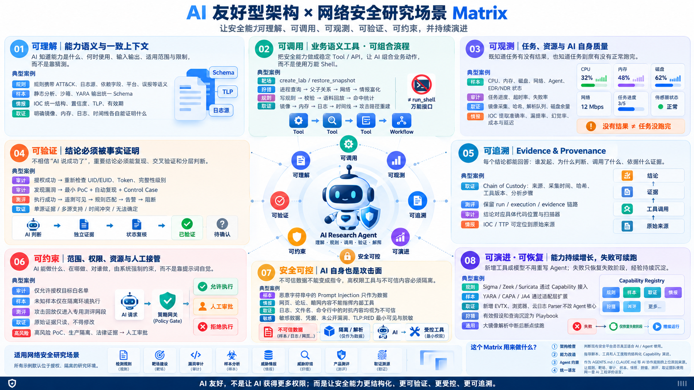

这两年谈 AI Agent，讨论很容易落到模型选型、上下文长度和工具数量上。但在实际工作里，我越来越觉得，模型能不能完成一项安全研究任务，往往不只取决于模型本身。

一个工具只有含糊的名字，没有输入输出约定；一个长任务只告诉 Agent“还在运行”，却没有进度和错误；一条检测结论只写“已经命中”，没有样本、遥测和规则之间的对账；一个高风险动作只靠提示词提醒“请谨慎”——这些问题换一个更强的模型，可能会缓解，却不会自然消失。

我因此整理了一个小项目：[AI-Friendly Architecture × Cybersecurity Research Matrix](https://github.com/stevenpsm/ai_friendly_architecture_security_matrix)。它不是一套已经建成的平台，而是一张架构检查表，以及由这张表派生出来的 Agent 执行契约。我想借它回答一个更基础的问题：当 AI 开始参与检测工程、威胁狩猎、样本分析、取证和产品测评时，支撑它的系统应该具备什么条件？

*这张矩阵把八个架构维度放进检测规则、靶场、漏洞审计、样本、情报、狩猎、产品测评和取证场景中。*

## “AI 友好”首先是把隐性知识变成显式结构

安全研究中有大量默认只存在于人脑里的判断。

做规则的人知道某段白名单为什么不能删，做取证的人知道“解析失败”不等于“证据不存在”，做测评的人知道攻击执行成功、遥测可见、规则匹配、产生告警和完成阻断是五件不同的事。人长期在一个系统里工作，会自然补全这些上下文；Agent 不会，至少不能被假设为一定会。

所以矩阵的第一个维度不是自动化，而是可理解：能力是什么，什么时候用，需要什么输入，会产出什么，适用范围和限制是什么。规则需要日志源、字段依赖、平台和误报语义；取证工具需要说明它能回答的问题以及证据局限；靶场需要显式拓扑、漏洞点、预期攻击路径和预期告警。

这看起来像文档工作，实际上是在定义系统的语义边界。语义不清楚，后面的自动编排只是把猜测执行得更快。

## 工具不应只是一个更方便的 Shell

Agent 当然可以拼接命令，但如果平台只提供一个万能命令入口，就很难稳定回答几个关键问题：这次调用要解决什么业务问题，输入是否合法，失败能否重试，输出能否进入下一步，以及它是否会产生副作用。

我更倾向于把能力封装成业务动作。例如，规则开发不是“运行一段命令”，而是 `validate_rule()`、`run_rule_against_corpus()` 和 `get_hit_stats()`；取证不是让模型自己寻找解析器参数，而是 `build_host_timeline()` 和 `correlate_artifacts()`；测评则可以由标准化的 `replay_attack(case_id, target)` 驱动。

这种封装并不是为了让接口看起来整齐。它让幂等、错误类型、权限检查、审计记录和结构化结果有了落点，也让多个低耦合能力能够组成一条可恢复的流程。

## 安全研究比一般 Agent 场景多了两道硬约束

第一道是证据。

在安全工作里，“模型认为成功”没有太大意义。漏洞是否存在，需要最小复现和对照用例；提权是否成功，需要重新读取权限状态并与基线比较；样本家族判断需要和静态特征、行为、网络活动及其他分析结果交叉验证；检测效果则应拆成执行、遥测、匹配、告警和阻断逐层对账。

因此，矩阵把可验证和可追溯分开处理：前者要求结论能被独立事实确认，后者要求结论能回到谁发起、为什么判断、调用了什么工具、获得了什么证据。两者缺一不可。只有证据没有来源，难以复核；只有调用日志没有独立验证，也只是记录了一次可能错误的执行。

第二道是边界。

安全 Agent 接触的输入本身可能带有对抗性。样本字符串、网页、日志、文件名和命令行里出现的“忽略之前指令”，都只能作为数据处理，不能升级成指令。同时，授权范围、隔离网段、原始证据只读、资源配额和人工审批，不能只依赖模型自觉。

这也是我对“AI 友好”最想强调的一点：它不是让 AI 获得更多权限，而是让权限更小、边界更清楚、过程更可见，在需要时能够可靠停下来交给人。

## 从一张矩阵到一份执行契约

项目里目前有两份核心文档。

`ai_friendly_architecture_security_matrix.md` 面向架构设计和评审。它把可理解、可调用与可组合、可观测、可验证、可追溯、可约束、安全可控、可演进与可恢复八组维度，映射到八类安全研究场景。

`AGENTS.md` 则把其中一部分原则转成运行时条款，用 `MUST` 和 `SHOULD` 约束 Agent：执行攻击性任务前确认授权与白名单，结论附证据和置信分级，高风险动作进入人工接管，不可信内容不能变成指令，任务完成需要满足明确的验证条件。

这两份文档刻意分开。矩阵解释为什么这样设计，契约说明 Agent 在当前项目里应怎样行动。把完整架构分析全部塞进上下文，会增加噪声；只留下几条简短禁令，又容易失去适用条件。

但我并不认为写好一份 `AGENTS.md` 就完成了治理。提示词是第二道防线。真正的白名单应由网关检查，样本应被隔离，原始证据应通过权限系统保持只读，生产处置和对外归因应有不可绕过的审批流程。凡是能够由系统强制保证的约束，都不应长期依赖模型“记住”。

## 我准备怎样使用这张矩阵

它目前最适合做三件事。

第一，做架构评审。不是笼统地问“平台是否支持 AI”，而是逐项检查能力语义、状态观测、证据闭环、权限边界和恢复机制。

第二，做项目契约。针对具体业务裁剪 `AGENTS.md`，把授权编号、目标范围、资源上限、数据分级、工具清单和验证命令替换成真实配置。

第三，做回归评测。设计一些故意缺少授权、超出白名单、包含提示注入、只有单一证据或要求高风险处置的任务，观察 Agent 是否在正确的位置拒绝、降级结论或请求人工确认。更换模型、工具或契约后，再跑同一组用例。

我希望它最终不是一张越来越大的表，而是一套会被失败案例不断修正的检查方法。某条约束如果总被违反，需要先判断它是否写得含糊；如果它本来就不该由模型决定，就应该下沉到架构里。

## 目前的边界

这个项目仍是第一版，产出主要是矩阵、执行契约和可视化说明。它没有替任何团队完成工具封装、Schema、策略网关、证据存储或评测集建设，也不是一份合规标准。

不同安全团队的边界差异很大。检测规则、样本分析和法律取证不应共享完全相同的权限与完成定义。仓库里的占位符和场景条款必须根据真实环境裁剪，不能原样复制后就当作已经建立了安全控制。

我仍然愿意把它公开，是因为这些问题需要更具体的反例。哪些条款在真实流程里执行不下去，哪些边界应该由工具强制，哪些指标看似合理却无法采集，都比继续增加抽象概念更能推动这张矩阵成熟。

对我来说，AI 友好型架构最终并不是一种专门讨好模型的新架构。它只是迫使我们把原本依赖经验维持的系统，重新做得更清楚、更可测，也更容易被人审阅。
